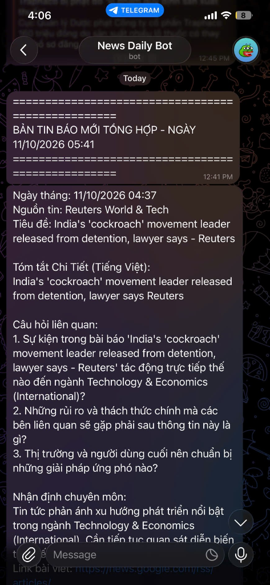
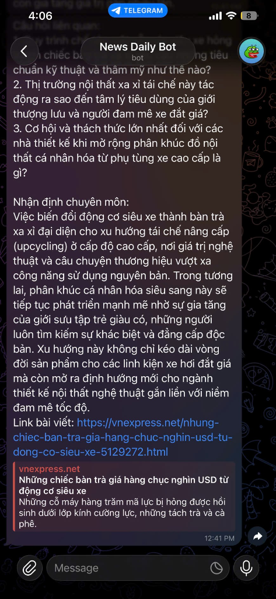

#  Daily News Telegram Bot (Pet Project)

> **A personal automation tool** that aggregates daily breaking news from global and Vietnamese publishers, analyzes them using **Google Gemini AI** (dual English & Vietnamese summaries, expert insights, and critical questions), and delivers a neat morning briefing straight to Telegram every day at **$0 hosting cost** via GitHub Actions.

---

##  Showcase & Results (Demo)

Each morning, a formatted report is sent directly to Telegram with clean separation, bilingual summaries, analytical questions, and market predictions:

| Daily Morning Briefing & Bilingual Digest | Expert Insights & Source Article Link |
| :---: | :---: |
|  |  |

---

##  Tech Stack

* **Language & Runtime:** **Java 17 (LTS)** managed with **Apache Maven**.
* **AI Engine:** **Google Gemini API** (`gemini-3.6-flash`) for deep text analysis, 8–12 sentence analytical summaries, market foresight, and critical question generation.
* **Web Scraping & RSS:**
  * **ROME Tools** (`rome`): Standard RSS 2.0 / Atom feed parser for Reuters, TechCrunch, VnExpress, and CafeF.
  * **Jsoup**: HTML sanitizer and clean snippet extraction.
* **Data Processing:** **FasterXML Jackson** (`jackson-databind`) for config file loading and Gemini JSON output parsing.
* **Notification Channel:** **Telegram Bot API** via Java's native asynchronous `HttpClient`.
* **CI/CD & Serverless Automation:** **GitHub Actions** scheduled cron workflow running daily at 07:15 AM (UTC+7) without requiring any dedicated VPS or running computer.

---

## Repository Structure

```text
newspaper/
├── .github/workflows/
│   └── daily-news.yml             # GitHub Actions cron scheduler workflow
├── assets/images/                 # Screenshot demo assets
│   ├── telegram-demo-1.png
│   └── telegram-demo-2.png
├── src/
│   ├── main/
│   │   ├── java/com/newsbot/
│   │   │   ├── ai/                # AI integration (GeminiSummarizer, AISummarizer)
│   │   │   ├── config/            # Bot and feed configurations
│   │   │   ├── model/             # Domain models (NewsItem, BotConfig)
│   │   │   ├── notifier/          # Delivery service (TelegramNotificationService, MessageFormatter)
│   │   │   ├── scraper/           # RSS fetching and content scraping
│   │   │   └── Main.java          # Application orchestrator & entry point
│   │   └── resources/
│   │       └── config.json        # News feeds list and per-source limits
│   └── test/                      # Unit tests for scraper & message formatting
├── pom.xml                        # Maven dependencies & Shade plugin for executable Fat JAR
└── README.md                      # Project documentation
```

---

## ⚙️ Installation & Usage Guide

### 1. Prerequisites & API Credentials
You need three credentials:
* `TELEGRAM_BOT_TOKEN`: Create a bot for free via [@BotFather](https://t.me/BotFather).
* `TELEGRAM_CHAT_ID`: Retrieve your personal chat ID from [@userinfobot](https://t.me/userinfobot).
* `GEMINI_API_KEY`: Grab a free API key from [Google AI Studio](https://aistudio.google.com/).

---

### 2. Running Locally

Make sure you have **JDK 17+** and **Maven** installed.

```bash
# 1. Clone the repository
git clone https://github.com/KhacToanNguyen-23/java-news-bot.git
cd java-news-bot

# 2. Set environment variables (PowerShell)
$env:TELEGRAM_BOT_TOKEN="your_telegram_bot_token"
$env:TELEGRAM_CHAT_ID="your_telegram_chat_id"
$env:GEMINI_API_KEY="your_gemini_api_key"

# 3. Build executable Fat JAR
mvn clean package -DskipTests

# 4. Run the bot
java -jar target/java-news-bot-1.0.0.jar
```

---

### 3. Fully Automated via GitHub Actions (Recommended)

No server or running laptop needed—GitHub handles the daily execution:

1. Fork or push this repository to your personal GitHub account.
2. Navigate to **Settings** ➔ **Secrets and variables** ➔ **Actions** ➔ Click **New repository secret**.
3. Add the 3 secrets:
   * `TELEGRAM_BOT_TOKEN`
   * `TELEGRAM_CHAT_ID`
   * `GEMINI_API_KEY`
4. **Done!** The bot runs automatically every morning at **07:15 AM (UTC+7)**. You can also trigger it manually at any time by going to the **Actions** tab ➔ **Daily News Aggregator Bot** ➔ **Run workflow**.

---

##  Customizing News Sources (`config.json`)

To add or remove news publishers, simply update `src/main/resources/config.json`:

```json
{
  "maxArticlesPerSource": 2,
  "enableAiSummary": true,
  "sources": [
    {
      "name": "Reuters World & Tech",
      "url": "https://news.google.com/rss/search?q=site:reuters.com+when:24h&hl=en-US&gl=US&ceid=US:en",
      "category": "Technology & Economics (International)"
    },
    {
      "name": "TechCrunch",
      "url": "https://techcrunch.com/feed/",
      "category": "Technology (International)"
    },
    {
      "name": "VnExpress Tin Mới Nhất",
      "url": "https://vnexpress.net/rss/tin-moi-nhat.rss",
      "category": "Technology & Economics"
    }
  ]
}
```

---

## 📜 License

This is an open-source pet project distributed under the [MIT License](LICENSE). Feel free to adapt and customize it for your personal daily news digest!
